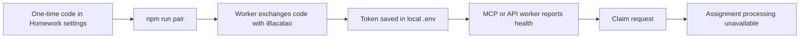

<p align="center">
  
</p>

<p align="center">
  <a href="#quick-start">Quick start</a> ·
  <a href="#what-works-today">Current status</a> ·
  <a href="docs/PROTOCOL.md">Protocol</a> ·
  <a href="SECURITY.md">Security</a>
</p>

<p align="center"><strong>Pairing and worker status work. Assignment processing is not available yet.</strong></p>

## What works today

> [!IMPORTANT]
> You can pair the worker and check its connection, but the current iBacalao integration does not send assignments to the agent or create drafts. **Use it for setup and status only; it cannot process homework yet.**

| Works now | Not available yet |
|---|---|
| Pair the local worker with a one-time Homework setup code. | Send assignment prompts to a model. |
| Save the agent token to local `.env` with owner-only permissions. | Generate and save drafts for review. |
| Report worker health to iBacalao. | Save completed work for student review. |

The worker never submits work to a school platform. See the [agent protocol](docs/PROTOCOL.md) for technical details.

## This repository

This is the local TypeScript worker and its static UI preview. It contains the pairing command, agent health reporting, an MCP server, and an OpenAI-compatible API runner. The model paths are present, but the current iBacalao integration pauses before any assignment prompt reaches them.

## Quick start

Requires Node.js 20 or newer.

```sh
git clone https://github.com/vibecode-king/ibacalao-homework-automation.git
cd ibacalao-homework-automation
npm ci
```

In iBacalao, open **Homework → Setup** and create a one-time pairing code. It expires after ten minutes and can be used once. Then pair this computer:

```sh
npm run pair
```

Enter the server URL shown in Homework settings, then paste the code. The worker exchanges it directly with iBacalao and saves the server URL and long-lived token in `.env` with owner-only permissions. The token is not printed or sent through the browser. A new pairing rotates the previous token. **Never commit `.env`.**

For a Vercel preview, enter that exact preview URL when `npm run pair` asks for the server URL.

## Choose a model path

The worker includes two ways to connect a model. The current iBacalao integration does not pass assignments to either one yet.

| | MCP host | API or local model |
|---|---|---|
| Start | MCP-capable AI app launches `src/mcp.ts` | `npm run once` or `npm start` |
| Model access | Your MCP app uses its configured AI plan or model | Your OpenAI-compatible endpoint and optional API key |
| Credential in worker | iBacalao agent token | iBacalao agent token and model settings |
| Assignment processing | Not available yet | Not available yet |

<details>
<summary><strong>MCP configuration</strong></summary>

After pairing, copy `IBACALAO_BASE_URL` and `IBACALAO_AGENT_TOKEN` from your local `.env` into your AI app's MCP configuration. Replace both paths with the absolute path to your clone. Protect the config file because it contains the long-lived token.

```json
{
  "mcpServers": {
    "ibacalao-homework": {
      "command": "/absolute/path/to/ibacalao-homework-automation/node_modules/.bin/tsx",
      "args": ["/absolute/path/to/ibacalao-homework-automation/src/mcp.ts"],
      "env": {
        "IBACALAO_BASE_URL": "https://app.ibacalao.com",
        "IBACALAO_AGENT_TOKEN": "<copy from your local .env>"
      }
    }
  }
}
```

The MCP server can report its status. Its assignment tools are not active in the current iBacalao integration, so it will not fetch homework or send a prompt to your AI app.

</details>

<details>
<summary><strong>API key or local model</strong></summary>

Add your model settings to the `.env` created by pairing. Set `IBACALAO_LLM_API_KEY` to use OpenAI's default endpoint, or set `IBACALAO_LLM_BASE_URL` to use another OpenAI-compatible `/chat/completions` endpoint. A local model server may not need an API key.

| Variable | Purpose |
|---|---|
| `IBACALAO_BASE_URL` | iBacalao server URL, saved by pairing. HTTPS is required except for localhost. |
| `IBACALAO_AGENT_TOKEN` | Long-lived agent token, saved by pairing. Keep it secret. |
| `IBACALAO_LLM_BASE_URL` | OpenAI-compatible model endpoint. |
| `IBACALAO_LLM_API_KEY` | Your key for the configured model endpoint. |
| `IBACALAO_LLM_MODEL` | Model name sent to the endpoint. |
| `IBACALAO_LLM_MAX_TOKENS` | Output cap per draft; defaults to 8,000 and accepts values from 1 to 32,000. |

The scripts read environment variables from the process; they do not load `.env` automatically. In macOS/Linux bash or zsh, load it and check the connection:

```sh
set -a
. ./.env
set +a
npm run once   # one cycle; reports that assignment processing is unavailable
# or:
npm start      # keep polling and reporting health
```

See [.env.example](.env.example) for the model settings template. On Windows, set the values in your shell or MCP app configuration.

</details>

<details>
<summary><strong>How pairing and claiming work</strong></summary>



Pairing uses a short-lived code. The browser does not receive the long-lived token; the local worker writes it to `.env` with owner-only permissions. After pairing, both worker modes can report status. Assignment content is not currently passed to a model.

</details>

## Project layout

| Path | Purpose |
|---|---|
| `src/pair.ts` | One-time pairing and local token storage |
| `src/ping.ts` | API worker polling and health reporting |
| `src/mcp.ts` | MCP server and homework tools |
| `src/agentRunner.ts` | OpenAI-compatible model request handling |
| `src/client.ts` | iBacalao API client |
| `app-preview.html` | Static UI preview; separate from the live worker connection |
| `docs/PROTOCOL.md` | Pairing, health, and job endpoint contract |

## Privacy and security

- The pairing code is exchanged directly between the local worker and iBacalao. The long-lived token is stored in `.env` with owner-only permissions and must not be committed.
- In API mode, assignment content goes to the model endpoint you configure. In MCP mode, your AI app may pass it to its model provider. The current integration does not send assignment content to either model path.
- Non-local server URLs require HTTPS, redirects are refused, and upstream responses are size-limited. Unsandboxed local AI CLI execution is disabled.
- Treat assignment text as untrusted data. Review your provider's retention settings and send only material you are allowed to share.

For vulnerability reports, follow [SECURITY.md](SECURITY.md).

## Development

```sh
npm run check
```

See [CONTRIBUTING.md](CONTRIBUTING.md) for contribution guidance. Licensed under the [MIT License](LICENSE).
