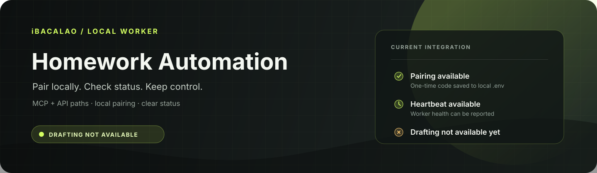
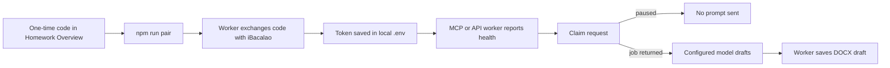

<p align="center">
  
</p>

<p align="center">
  <a href="#quick-start">Quick start</a> ·
  <a href="#what-works-today">Current status</a> ·
  <a href="docs/PROTOCOL.md">Protocol</a> ·
  <a href="SECURITY.md">Security</a>
</p>

<p align="center"><strong>The worker supports DOCX draft handoff. Job processing requires a compatible iBacalao server.</strong></p>

## What works today

> [!IMPORTANT]
> The worker can claim jobs, send prompts to your selected model, package plain text or Markdown as DOCX, and upload drafts for review when the connected server enables the matching job and DOCX endpoints. A server response with `paused: true` means no assignment prompt is sent to the model.

| Worker capability | Server requirement |
|---|---|
| Pair with a one-time Homework setup code and save the token in local `.env` with owner-only permissions. | The server must release a job to the worker. |
| Report worker health and job status. | The completion endpoint must accept the documented multipart DOCX contract. |
| Use an MCP host or an OpenAI-compatible model endpoint to draft from a claimed prompt. | The student reviews and edits the saved draft; the worker never submits it to a school. |

The worker never submits work to a school platform. See the [agent protocol](docs/PROTOCOL.md) for technical details.

## This repository

This repository contains the local TypeScript worker and its static UI preview. It includes pairing, health reporting, an MCP server, and an OpenAI-compatible API runner. When a compatible server returns a job, the worker sends its prompt to the configured model and uploads the resulting DOCX draft for review.

## Quick start

Requires Node.js 20 or newer.

```sh
git clone https://github.com/vibecode-king/ibacalao-homework-automation.git
cd ibacalao-homework-automation
npm ci
```

In Homework, open **Overview → Connect the Homework worker** and create a one-time pairing code. It expires after ten minutes and can be used once. Then pair this computer:

```sh
npm run pair
```

Enter the server URL shown in Homework Overview, then paste the code. The worker exchanges it directly with iBacalao and saves the server URL and long-lived token in `.env` with owner-only permissions. The token is not printed or sent through the browser. A new pairing rotates the previous token. **Never commit `.env`.**

For a Vercel preview, enter that exact preview URL when `npm run pair` asks for the server URL.

## Choose a model path

The worker includes two ways to connect a model. Assignment prompts reach the selected model only after the iBacalao server returns a claimed job; a paused claim sends no prompt.

| | MCP host | API or local model |
|---|---|---|
| Start | MCP-capable AI app launches `src/mcp.ts` | `npm run once` or `npm start` |
| Model access | Your MCP app uses its configured AI plan or model | Your OpenAI-compatible endpoint and optional API key |
| Credential in worker | iBacalao agent token | iBacalao agent token and model settings |
| Assignment processing | Claim and submit through the MCP tools when enabled by the server | Claim, draft, and submit when enabled by the server |

<details>
<summary><strong>MCP configuration</strong></summary>

After pairing, copy `IBACALAO_BASE_URL` and `IBACALAO_AGENT_TOKEN` from your local `.env` into your AI app's MCP configuration. Replace both paths with the absolute path to your clone. Protect the config file because it contains the long-lived token.

```json
{
  "mcpServers": {
    "ibacalao-homework": {
      "command": "/absolute/path/to/ibacalao-homework-automation/node_modules/.bin/tsx",
      "args": ["/absolute/path/to/ibacalao-homework-automation/src/mcp.ts"],
      "env": {
        "IBACALAO_BASE_URL": "https://app.ibacalao.com",
        "IBACALAO_AGENT_TOKEN": "<copy from your local .env>"
      }
    }
  }
}
```

The MCP server exposes `claim_homework_job`, `submit_homework_draft`, and `fail_homework_job`. After a successful claim, the host AI app receives the assignment prompt and job-scoped claim token. It supplies the completed draft as plain text or Markdown; this server packages it as DOCX and uploads it to iBacalao. Your AI app may send the prompt and draft to its configured model provider. Treat assignment text as untrusted input and use a chat without unrelated powerful tools enabled.

</details>

<details>
<summary><strong>API key or local model</strong></summary>

Add your model settings to the `.env` created by pairing. Set `IBACALAO_LLM_API_KEY` to use OpenAI's default endpoint, or set `IBACALAO_LLM_BASE_URL` to use another OpenAI-compatible `/chat/completions` endpoint. A local model server may not need an API key.

| Variable | Purpose |
|---|---|
| `IBACALAO_BASE_URL` | iBacalao server URL, saved by pairing. HTTPS is required except for localhost. |
| `IBACALAO_AGENT_TOKEN` | Long-lived agent token, saved by pairing. Keep it secret. |
| `IBACALAO_LLM_BASE_URL` | OpenAI-compatible model endpoint. |
| `IBACALAO_LLM_API_KEY` | Your key for the configured model endpoint. |
| `IBACALAO_LLM_MODEL` | Model name sent to the endpoint. |
| `IBACALAO_LLM_MAX_TOKENS` | Output cap per draft; defaults to 8,000 and accepts values from 1 to 32,000. |

The scripts read environment variables from the process; they do not load `.env` automatically. In macOS/Linux bash or zsh, load it and check the connection:

```sh
set -a
. ./.env
set +a
npm run once   # process one job if the server releases one
# or:
npm start      # keep polling and reporting health
```

See [.env.example](.env.example) for the model settings template. On Windows, set the values in your shell or MCP app configuration.

</details>

In a compatible iBacalao app, the student can download the saved Word draft, edit it in Microsoft Word or another compatible editor, and upload the edited `.docx` for review. The app validates the DOCX package and rejects stale saves. Nothing is submitted to a school platform.

<details>
<summary><strong>How pairing and claiming work</strong></summary>



Pairing uses a short-lived code. The browser does not receive the long-lived token; the local worker writes it to `.env` with owner-only permissions. Both worker modes can report status. Assignment content reaches a model only after a server returns a claimed job.

</details>

## Project layout

| Path | Purpose |
|---|---|
| `src/pair.ts` | One-time pairing and local token storage |
| `src/ping.ts` | API worker polling and health reporting |
| `src/mcp.ts` | MCP server and homework tools |
| `src/agentRunner.ts` | OpenAI-compatible model request handling |
| `src/client.ts` | iBacalao API client |
| `app-preview.html` | Static UI preview; separate from the live worker connection |
| `docs/PROTOCOL.md` | Pairing, health, and job endpoint contract |

## Privacy and security

- The pairing code is exchanged directly between the local worker and iBacalao. The long-lived token is stored in `.env` with owner-only permissions and must not be committed.
- In API mode, a claimed assignment prompt goes to the model endpoint you configure. In MCP mode, the prompt and claim token are returned to your AI app, which may send the prompt to its model provider. A paused claim returns no assignment prompt.
- Non-local server URLs require HTTPS, redirects are refused, and upstream responses are size-limited. Unsandboxed local AI CLI execution is disabled.
- Treat assignment text as untrusted data. Review your provider's retention settings and send only material you are allowed to share.

For vulnerability reports, follow [SECURITY.md](SECURITY.md).

## Development

```sh
npm run check
```

See [CONTRIBUTING.md](CONTRIBUTING.md) for contribution guidance. Licensed under the [MIT License](LICENSE).
