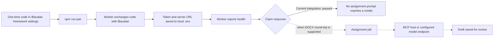

<div align="center">

# iBacalao Homework Automation

### A local worker for pairing and agent health.

[](https://nodejs.org/)
[](https://www.typescriptlang.org/)
[](https://modelcontextprotocol.io/)
[](LICENSE)

[Quick start](#quick-start) · [Current status](#current-status) · [Privacy](#privacy-and-security) · [Protocol](docs/PROTOCOL.md)

</div>

This repository contains a local TypeScript worker for pairing with iBacalao and reporting agent health. It also includes MCP and OpenAI-compatible model paths for the homework workflow, which cannot process assignments until end-to-end DOCX-preserving generation and editing are implemented.

> [!IMPORTANT]
> **Assignment processing is currently paused in the iBacalao integration.** Pairing and agent heartbeats work, but the server does not release assignment content until DOCX-preserving generation and editing are ready. The worker receives a paused response before any prompt reaches a model. Do not use this integration to process assignments yet.

## Contents

- [Current status](#current-status)
- [How it works](#how-it-works)
- [Quick start](#quick-start)
- [MCP mode](#mcp-mode)
- [API and local-model mode](#api-and-local-model-mode)
- [Privacy and security](#privacy-and-security)
- [Responsible use](#responsible-use)
- [Development](#development)

## Current status

| Available now | Paused until DOCX round-trip support is ready |
|---|---|
| Pair the local worker with a one-time code from iBacalao Homework settings. | Claim and generate assignment drafts. |
| Save the long-lived agent token in local `.env` with owner-only file permissions. | Send assignment prompts to an AI provider. |
| Report the worker's heartbeat to iBacalao. | Save generated HTML as a student document. |

The current server responds to job claims with `paused: true` and reason `docx_round_trip_not_ready`; it rejects the legacy `artifactHtml` completion format. That field is HTML and is **not** a DOCX file. See the [protocol notes](docs/PROTOCOL.md).

## How it works



The worker includes an MCP server and an API/local-model runner. Both depend on server support for the document format; the current iBacalao integration pauses before exposing assignment content.

## Quick start

### 1. Install

Use Node.js 20 or newer.

```bash
git clone https://github.com/vibecode-king/ibacalao-homework-automation.git
cd ibacalao-homework-automation
npm ci
```

### 2. Pair this computer

In iBacalao, open **Homework → Setup** and create a one-time pairing code. It expires after ten minutes and can be used once.

Run the pairing command:

```bash
npm run pair
```

Enter the same server URL shown in Homework settings, then paste the code. The worker exchanges it directly with iBacalao and saves the server URL and long-lived token to `.env` with owner-only permissions. The token is not printed or sent through the browser. A new pairing rotates the previous agent token.

Do not commit `.env`. It is ignored by Git.

### 3. Check the connection

The worker can report a heartbeat while processing is paused. To run API mode, configure your model endpoint as described below, load `.env` into your shell, and run `npm run once` or `npm start`. The current integration will report that drafting is paused; it will not send assignment content to the configured model.

```bash
set -a
. ./.env
set +a
npm run once   # one claim/health cycle
# or:
npm start      # keep polling and reporting health
```

For a Vercel preview, enter that exact preview deployment URL when `npm run pair` asks for the server URL. The worker saves it for later requests.

## MCP mode

After pairing, add the server to an MCP-capable AI app. Replace both paths with the absolute path to your clone. Copy `IBACALAO_BASE_URL` and `IBACALAO_AGENT_TOKEN` from your local `.env` into the app configuration, and protect the configuration because it contains the long-lived token.

```json
{
  "mcpServers": {
    "ibacalao-homework": {
      "command": "/absolute/path/to/ibacalao-homework-automation/node_modules/.bin/tsx",
      "args": ["/absolute/path/to/ibacalao-homework-automation/src/mcp.ts"],
      "env": {
        "IBACALAO_BASE_URL": "https://app.ibacalao.com",
        "IBACALAO_AGENT_TOKEN": "<copy from your local .env>"
      }
    }
  }
}
```

The MCP server registers `claim_homework_job`, `submit_homework_draft`, and `fail_homework_job`, and can report health. Currently, `claim_homework_job` returns a paused message before it returns a prompt or job-scoped claim token. The completion tool sends the legacy HTML format, which the current iBacalao integration rejects. It never submits work to a school platform.

## API and local-model mode

`npm start` runs the API worker. It uses your own API key or an OpenAI-compatible model endpoint. Configure model settings in the local `.env` created by `npm run pair`:

| Variable | Purpose |
|---|---|
| `IBACALAO_BASE_URL` | iBacalao server URL, saved by pairing. HTTPS is required except for localhost. |
| `IBACALAO_AGENT_TOKEN` | Long-lived token, saved by pairing. Keep it secret. |
| `IBACALAO_LLM_BASE_URL` | OpenAI-compatible `/chat/completions` endpoint. Leave blank to use OpenAI's default when an API key is set. |
| `IBACALAO_LLM_API_KEY` | Your key for the configured model endpoint. Local model servers may not need one. |
| `IBACALAO_LLM_MODEL` | Model name sent to the endpoint. |
| `IBACALAO_LLM_MAX_TOKENS` | Output cap per draft; defaults to 8,000 and accepts values from 1 to 32,000. |

See [.env.example](.env.example) for the model settings template. The scripts read variables from the process and do not load `.env` automatically. On Windows, set them in your shell or MCP app configuration.

## Privacy and security

- **Pairing stays local.** The worker exchanges the short-lived code directly with iBacalao. The server returns the long-lived token to the worker, which writes it to `.env` with owner-only permissions.
- **You choose the model service.** In API mode, the full assignment prompt is sent to the configured endpoint when the server provides one. In MCP mode, the MCP host and its model provider may receive the prompt and job-scoped claim token. The current paused response contains neither.
- **Protect credentials.** The agent token is required for iBacalao requests. Your model key is sent to the endpoint you configure. Do not commit tokens, API keys, `.env` files, logs, or real student data.
- **Network requests are constrained.** Non-local server URLs require HTTPS, redirects are refused, and upstream responses are size-limited. Unsandboxed local AI CLI execution is disabled.
- **The server must sanitize generated HTML.** The legacy protocol requires server-side sanitization before storage or rendering. The local worker does not sanitize HTML itself, and HTML is not a DOCX round trip. See [docs/PROTOCOL.md](docs/PROTOCOL.md).

For vulnerability reports, follow [SECURITY.md](SECURITY.md).

## Responsible use

When assignment processing is enabled, treat generated work as a draft: review it, verify its accuracy, edit it, and follow your school's academic integrity rules. You are responsible for what you submit.

## Development

```bash
npm run check   # TypeScript typecheck and tests; no network or real keys required
```

See [CONTRIBUTING.md](CONTRIBUTING.md) for contribution guidance. Licensed under the [MIT License](LICENSE).
